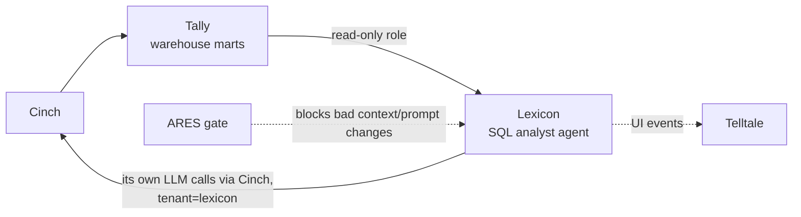

# Lexicon: Objective and What To Do

> A text-to-SQL agent over Tally's own data. An ablation shows that **the context you give it matters more than the model you pick**.

The name fits the thesis: the project is about giving the agent the *meaning* of the data (what tables mean, how metrics are defined, which business rules apply), not just the schema.

---

## 1. The question Lexicon answers

"How much of text-to-SQL accuracy comes from the model, and how much from the context layer around it? And can an agent know when to ask instead of guess?"

Most text-to-SQL demos stop at "it wrote a query". Lexicon measures four things:
- execution accuracy
- whether it asks for clarification when the question is ambiguous
- whether it refuses what it should refuse
- what each answer cost, as measured by Tally

Then it proves the thesis with a controlled ablation.

## 2. What you build

1. **A context layer.** `context/tables/<table>.yaml`, one file per Tally mart. Each file holds:
   - column meanings with sample values
   - synonyms ("spend" → `cost_usd`)
   - metric definitions (`cost_per_correct = ...`)
   - business rules ("a reopened ticket does not count as resolved")
   - allowed joins
   - 10–15 verified example queries

   A pydantic schema validates every file, and a CI check runs each file against the live warehouse.
2. **A LangGraph agent** with eight steps:

   | Step | What happens |
   |---|---|
   | 1. Classify | Decide what kind of question it is |
   | 2. Retrieve | Fetch the relevant tables, rules and examples |
   | 3. Clarify | If the question is ambiguous, ask the user (the Nexus refusal-gate idea, as a graph node) |
   | 4. Generate | Write the SQL |
   | 5. Guard | `sqlglot` checks it: read-only, allowlisted tables, enforced LIMIT |
   | 6. Execute | Run it with a timeout, on a read-only role |
   | 7. Sanity-check | Look for empty results, NULLs and implausible magnitudes |
   | 8. Answer | Return the SQL, a chart and the caveats |
3. **An evaluation suite.** A 120-question golden set in six buckets of 20: simple, multi-join, metric-definition, business-rule trap, should-clarify, should-refuse. Plus a 200-question stratified slice of BIRD Mini-Dev (PostgreSQL flavour), so outsiders have a number they can compare.
4. **The ablation (the money chart).** Four context levels:

   | Level | Context given |
   |---|---|
   | L0 | Schema only |
   | L1 | + column descriptions |
   | L2 | + business rules and metric definitions |
   | L3 | + verified examples |

   Each level is crossed with at least two models (local Qwen via Cinch, and one hosted model), with 3 seeds each. The chart shows whether the gap between context levels beats the gap between models.
5. **ARES integration.** Every change to a prompt or a context YAML goes through an ARES gate. The gate blocks the change if execution accuracy drops more than 2 points, or if any refusal or clarification bucket gets worse.

## 3. Deliverables (definition of done)

- `make eval`, `make ablation`, `make bird` and `make gate` all reproduce from a clean clone, against a frozen warehouse snapshot.
- A Streamlit app: chat, SQL shown, chart, caveats, and the clarification loop.
- The README leads with the ablation chart and a per-bucket results table, each citing a run id.
- An ARES gate plugin, packaged in this repo, plus a CI workflow that runs it on every PR touching `context/` or `prompts/`.
- Lexicon's own LLM traffic flows through Cinch with `X-Tenant-ID: lexicon`, so its cost per question appears in Tally's dashboard.

## 4. Success criteria

| Criterion | Bar |
|---|---|
| Thesis test | Ablation reported with CIs, whichever way it comes out. If model matters more than context, publish that. |
| Safety | Zero writes possible: red-team suite of ≥ 40 attack queries, all blocked, in CI |
| Clarification | Should-clarify recall ≥ 0.8 with false-clarify rate ≤ 10% on answerable buckets (targets; report actuals) |
| Refusal | Should-refuse accuracy reported per sub-type (write ops, out-of-scope, PII, unanswerable) |
| External anchor | BIRD Mini-Dev slice EX reported with the exact question ids, so anyone can rerun it |
| Engineering | ≥ 85% coverage, 100% branch coverage on the SQL guard, ruff + mypy clean |

## 5. Non-goals

- Beating the BIRD leaderboard. BIRD is there to anchor the number, not to compete on it.
- Write-capable SQL, or any agent action beyond SELECT.
- Building a semantic-layer product. The YAML context borrows conventions from dbt MetricFlow and the Open Semantic Interchange spec, without trying to replace them.

## 6. Where Lexicon sits

## 7. Timeline

About 4 weeks (portfolio weeks 6–9). Telltale's instrumentation starts in parallel during these weeks. Details are in [`docs/ROADMAP.md`](docs/ROADMAP.md).

## 8. Doc map

| File | Purpose |
|---|---|
| `AGENTS.md`, `CLAUDE.md`, `GEMINI.md` | Rules for coding agents |
| `docs/BUILD_SPEC.md` | Full technical spec |
| `docs/ROADMAP.md` | Week-by-week plan |
| `docs/CONTEXT_YAML_SPEC.md` | The context-file format, field by field, with a complete example |
| `docs/GOLDEN_SET_GUIDE.md` | How to write, label and review the 120 questions |
| `docs/ARES_CHANGES.md` | Optional ARES-side PR so the gate also runs as a service |
| `docs/DECISIONS.md` | ADRs |
| `docs/RESEARCH.md` | Sources and verified facts |
| `../Tally/docs/CONTRACTS.md` | The warehouse tables Lexicon reads |
