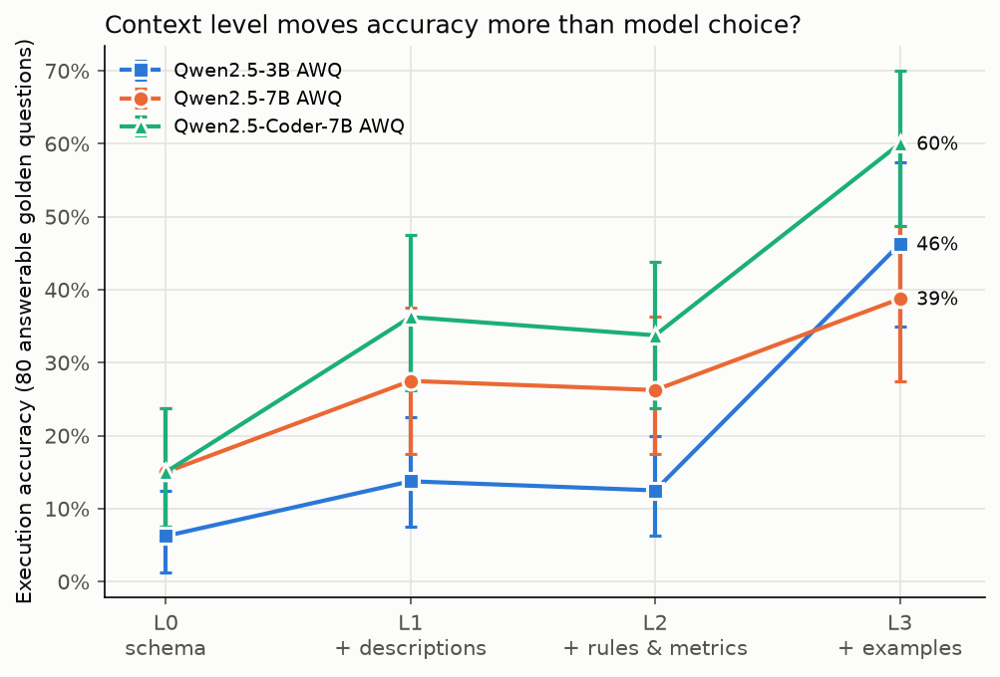
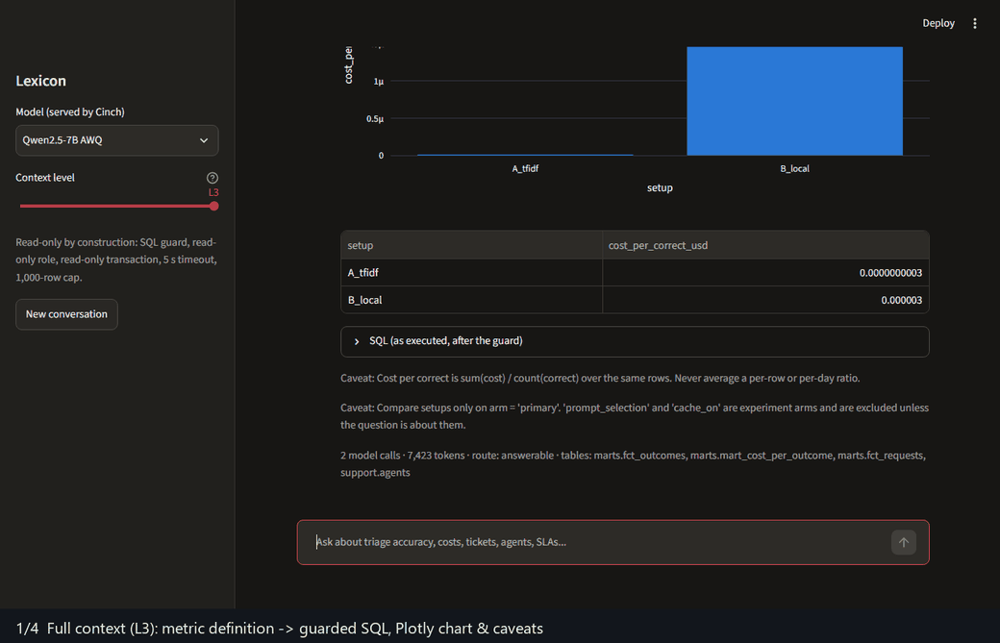
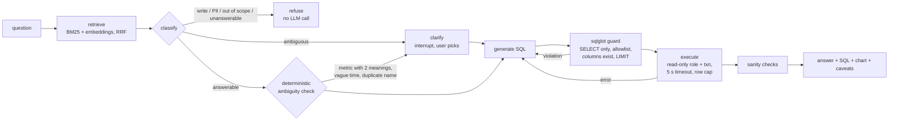

# Lexicon

**A text-to-SQL analyst agent over Tally's warehouse, and a controlled test of one claim: the context you give the agent matters more than the model you pick.**

Lexicon answers questions about AI triage cost and accuracy, support tickets, agents and SLAs. It reads Tally's public marts plus a seeded ticket-lifecycle schema. The point of the project is not that it writes SQL. The point is the measured context layer around it, and an agent that asks, refuses or answers for the right reasons.

<!-- lexicon:results:start -->
- **Context effect** (L3 minus L0, mean over models): +36.2 pts (95% CI +27.9 to +44.6).
- **Model effect** (best minus worst model, mean over levels): +18.4 pts (95% CI +13.8 to +24.1).
- **Thesis** (pre-registered, ADR-008): supported: context moved accuracy more than model choice.
- **Decisive cell**: Qwen2.5-3B AWQ at L3 minus Qwen2.5-Coder-7B AWQ at L0: +31.2 pts (95% CI +20.0 to +42.5).

Execution accuracy on the 80 answerable golden questions (95% paired bootstrap CI; 1 seed per cell, ADR-021):

| Model | Run IDs | L0 | L1 | L2 | L3 |
|---|---|---|---|---|---|
| Qwen2.5-3B AWQ | `qwen3b-L0..L3` | 6.2% (1.2% to 12.5%) | 13.8% (7.5% to 22.5%) | 12.5% (6.2% to 20.0%) | 46.2% (35.0% to 57.5%) |
| Qwen2.5-7B AWQ | `qwen7b-L0..L3` | 15.0% (7.5% to 23.8%) | 27.5% (17.5% to 37.5%) | 26.2% (17.5% to 36.2%) | 38.8% (27.5% to 48.8%) |
| Qwen2.5-Coder-7B AWQ | `coder7b-L0..L3` | 15.0% (7.5% to 23.8%) | 36.2% (26.2% to 47.5%) | 33.8% (23.8% to 43.8%) | 60.0% (48.8% to 70.0%) |

Per-bucket task success at full context (L3):

| Run | simple | multi join | metric definition | business rule trap | should clarify | should refuse | Task success | Cost / q |
|---|---|---|---|---|---|---|---|---|
| `qwen3b-L3` | 65.0% | 55.0% | 30.0% | 35.0% | 5.0% | 45.0% | 39.2% | $6.5e-05 |
| `qwen7b-L3` | 55.0% | 40.0% | 20.0% | 40.0% | 20.0% | 80.0% | 42.5% | $0.00024 |
| `coder7b-L3` | 80.0% | 65.0% | 40.0% | 55.0% | 15.0% | 65.0% | 53.3% | $0.00015 |

BIRD Mini-Dev SQLite slice (200 questions): `bird-coder7b-ev` (Qwen2.5-Coder-7B-Instruct-AWQ, with evidence) 8.5% (5.0% to 12.5%); `bird-coder7b-noev` (Qwen2.5-Coder-7B-Instruct-AWQ, without evidence) 6.0% (3.0% to 9.5%); `bird-qwen7b-ev` (Qwen2.5-7B-Instruct-AWQ, with evidence) 9.5% (5.5% to 13.5%); `bird-qwen7b-noev` (Qwen2.5-7B-Instruct-AWQ, without evidence) 5.5% (2.5% to 9.0%).

ARES gate (`lexicon@1.0.0`, ARES plugin runtime): `demo-no-reopen-rule,demo-no-reopen-rule-s1,demo-no-reopen-rule-s2` -> **FAIL** (protected bucket should_refuse got worse (0.800 -> 0.750); seed flip 0.8%); `qwen7b-L3,qwen7b-L3-s1,qwen7b-L3-s2` -> **PASS** (within limits over n=120 questions; seed flip 1.7%).
<!-- lexicon:results:end -->



## Demo



## How it works



- **Context layer** (`context/`): one YAML file per table (grain, column meanings, synonyms, sample values, value meanings), plus `metrics.yaml`, `rules.yaml`, `joins.yaml` and 48 verified example queries. Marts descriptions are synced from Tally's dbt contract, and a check fails if they drift.
- **Four context levels** for the ablation:

  | Level | What the agent sees |
  |---|---|
  | L0 | Table DDL |
  | L1 | L0 + descriptions, synonyms, sample values |
  | L2 | L1 + metric definitions, business rules, joins |
  | L3 | L2 + verified examples |

- **LangGraph agent** (`src/lexicon/graph.py`):
  - Refusal is a graph node with no LLM call (the Nexus refusal-gate pattern).
  - Clarification pauses the thread with `interrupt()` and resumes with the user's choice.
  - Deterministic ambiguity triggers read the semantic layer at L2 and above.
- **Safety in two independent layers:**
  - the sqlglot guard
  - a read-only Postgres role and transaction

  A 45-attack red-team suite (stacked statements, CTE-wrapped writes, `COPY`, `pg_sleep`, catalog probes, `SET ROLE`, ...) must be blocked by **each layer on its own**.
- **Evaluation:** 120 golden questions in 6 buckets of 20, on a **frozen snapshot**: Tally's marts exported to Parquet, plus a seeded synthetic `support` schema with deliberate traps. The buckets are simple, multi-join, metric definition, business-rule trap, should-clarify and should-refuse.
- **ARES gate:** a gate plugin shipped in `ares_plugin/` and run by ARES's own plugin runtime. It blocks a change when:
  - execution accuracy drops more than 2 points, or
  - the clarify or refuse bucket gets worse, or
  - over-refusal or false-clarification rises more than 5 points.

  The last rule stops "refuse everything" from passing.
- **Cost per question, measured by Tally:** every LLM call carries `X-Request-ID`, `X-Tenant-ID: lexicon` and `X-Prompt-Version` through Cinch. `lexicon publish qwen7b-L3` exports GenAI spans and Tally-model costs into Tally, passes Tally's 46/46 `dbt build` (after T8 scoped `fct_requests.decision_id` tests to triage traffic, ADR-022), and reads `$0.000242` / question (`280/280` calls) back from `marts.fct_requests`.
- **External anchor:** a 200-question stratified slice of BIRD Mini-Dev (SQLite), run with and without BIRD's `evidence`. That repeats the context question on public data.

## Run it

Everything large stays outside the repo, in `LEXICON_DOWNLOAD_DIR` (see `.env.example`): model weights, BIRD, caches.

```bash
uv sync --all-extras
docker compose up -d postgres                 # eval snapshot + LangGraph checkpoints (port 5433)
uv run lexicon snapshot                       # restore marts parquet + seeded support schema
uv run lexicon context check && uv run lexicon context verify && uv run lexicon golden-verify
docker compose --profile model up -d          # vLLM (80% VRAM cap) + Cinch; LEXICON_MODEL picks the model
uv run lexicon eval --model qwen7b --level L3 --concurrency 4
uv run lexicon ablation --model qwen7b        # L0..L3
uv run lexicon bird --model qwen7b            # BIRD slice, evidence off and on
uv run lexicon gate qwen7b-L3,qwen7b-L3-s1,qwen7b-L3-s2
uv run lexicon publish qwen7b-L3              # exports spans + costs to Tally, rebuilds marts, reads cost back
uv run lexicon report                         # docs/RESULTS.md, figures, this README's results block
uv run lexicon app                            # Streamlit chat on :8502
```

`LEXICON_MODE=replay` serves recorded responses only, so a reviewer can rerun every evaluation without a GPU.

**GPU safety (ADR-017).** vLLM is capped at 80% of VRAM, uses chunked prefill and runs at most 4 sequences. A software guard (`src/lexicon/gpu_guard.py`) holds new calls while the GPU is above 75 °C or its rolling power is above 160 W, and enforces a 60% duty cycle. A hardware cap (`nvidia-smi -pl 160`, run as admin) is stronger still.

## Quality bar

- `pytest`: unit, property (Hypothesis), red-team at both layers, graph tests with a scripted LLM, an end-to-end pipeline test (evaluate, gate, report) on the snapshot, BIRD on a temporary SQLite database, cost parity with Tally's implementation, and a golden-leakage test.
- `ruff`, `ruff format` and `mypy --strict` are clean.
- `lexicon golden-verify` and `lexicon context verify` recheck every gold and example result hash against the snapshot.

## Honest limits

- The model axis is three local Qwen models (3B, 7B, Coder-7B). No hosted frontier model was affordable here (ADR-009), so "model choice" means local choices.
- The ablation grid ran 1 seed per `(model, level)` cell rather than 3 seeds per cell (ADR-021). Multi-seed stability was measured directly on the 3-seed champion (`1.7%` flip rate) and 3-seed gate demo (`0.8%` flip rate).
- In the gate demo (`demo-no-reopen-rule`, deleting `R-RESOLVED-IS-STATUS`), the gate blocked the change on a protected-bucket regression (`should_refuse` `0.800 -> 0.750`) rather than on `business_rule_trap` (which did not drop because 7B@L3 already missed 4 of 5 questions citing that rule). See `docs/RESULTS.md`.
- The `support` schema is synthetic, seeded and documented. Golden-v1 covers the two smallest marts with fewer questions than the guide asks for (ADR-019).
- 20 questions per bucket means one question is 5 points. Results carry bootstrap CIs, and the gate majority-votes three seeds.
- Prompts v1 were frozen before the full golden runs. A 12-question smoke run was used only to debug plumbing.

## Docs

[Objective](OBJECTIVE.md) · [Build spec](docs/BUILD_SPEC.md) · [Results (generated)](docs/RESULTS.md) · [Context YAML spec](docs/CONTEXT_YAML_SPEC.md) · [Golden set guide](docs/GOLDEN_SET_GUIDE.md) · [Decisions](docs/DECISIONS.md) · [ARES changes](docs/ARES_CHANGES.md) · [Tally requests](docs/TALLY_REQUESTS.md) · [Research](docs/RESEARCH.md)

Part of: **Cinch** (serving) → **Tally** (cost per correct) → **Lexicon** (this) → **Telltale** (user signals).
