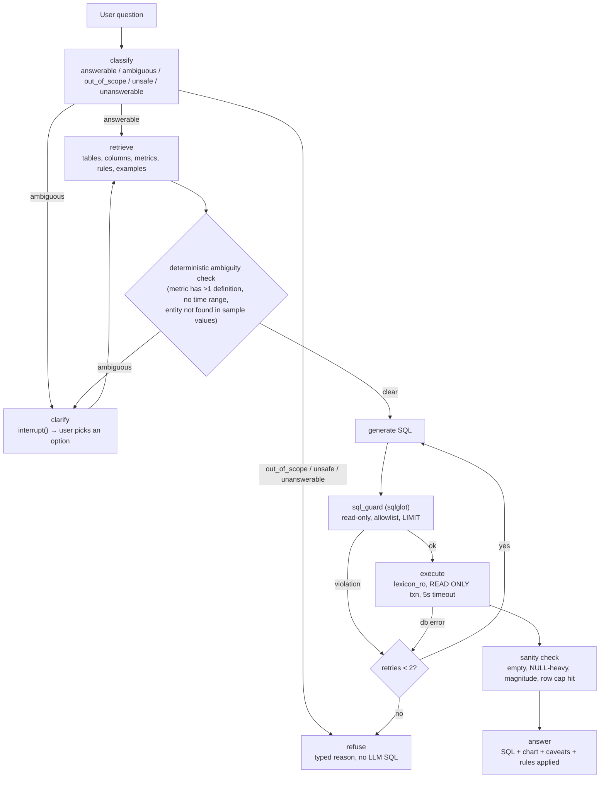

# Lexicon Build Spec

Status: v1, 2026-11-19. The objective and done-criteria are in `../OBJECTIVE.md`. [R§n] refers to `RESEARCH.md`. The warehouse contract is `../../Tally/docs/CONTRACTS.md`.

---

## 0. Design choices that sharpen the original pitch

| Pitch said | Spec does | Why |
|---|---|---|
| Ablation over 4 context levels | 4 levels × **3 models** (local Qwen 7B via Cinch, a cheap hosted model, a strong hosted model) × 3 seeds | "Context beats model choice" needs a model axis to compare against. The decisive cell is *small model + full context* vs *strong model + schema only*. |
| Golden set on Tally's data | Golden set on a **frozen snapshot** of Tally's marts | Tally keeps running, so live data would change the correct answers under you. |
| BIRD ~200 slice | 200 questions from **BIRD Mini-Dev, PostgreSQL flavour**, stratified by difficulty, plus a with/without-`evidence` ablation | Mini-Dev ships a Postgres version, which matches Lexicon's dialect, and has a public leaderboard [R§1]. BIRD's `evidence` field is external domain knowledge. Toggling it reproduces the context thesis on public data, which outsiders can check. |
| ARES gate: block if EX drops > 2 pts or any refusal bucket worsens | Implemented as an **ARES gate plugin shipped in this repo**, run in CI through ARES's own plugin runtime | ARES's HTTP compare endpoint always runs the `default` gate, which only knows `overall_accuracy` / `overall_f1` and absolute slice F1 floors [R§8]. A plugin needs no ARES edit. |
| Should-clarify bucket | Clarification scored twice: did it ask, and after a simulated answer, did it get the right result | Asking is half the job; the other half is using the answer. |

---

## 1. Architecture



- Built as a LangGraph `StateGraph` with a Postgres checkpointer (`langgraph-checkpoint-postgres`), so `interrupt()` clarifications survive restarts [R§4].
- Clarify uses `interrupt()`, and the UI resumes with `Command(resume=choice)`. Nodes must be idempotent before the interrupt, because a resumed node re-runs from the top [R§4].
- The **refuse** node, like Nexus's refusal gate, makes no LLM call. It returns a typed reason. This is a deliberate reuse of the Nexus pattern, a graph node rather than a prompt instruction: cite it.

### 1.1 State
```python
class LexState(TypedDict):
    question: str
    thread_id: str
    request_ids: list[str]           # every LLM call, for Tally cost join
    context_level: Literal["L0","L1","L2","L3"]
    route: Literal["answerable","ambiguous","out_of_scope","unsafe","unanswerable"] | None
    clarification: Clarification | None   # options offered, choice received
    retrieved: RetrievedContext | None    # table/column/metric/rule/example ids + text
    sql: str | None
    guard_report: GuardReport | None
    attempts: int
    result: ResultFrame | None            # columns, rows (capped), row_count, truncated
    sanity: list[SanityFlag]
    answer: Answer | None                 # text, sql, chart_spec, caveats, rules_applied
    refusal: Refusal | None               # type, message
```

---

## 2. Data sources

| Source | Use | Access |
|---|---|---|
| Tally `marts.*` (live) | The demo app | `lexicon_ro` role; see CONTRACTS §3 |
| **Frozen snapshot** of Tally marts | Golden-set eval, ablation, ARES gate | `evals/snapshot/tally_marts_<date>.sql` (`pg_dump --schema=marts --data-only` plus DDL), restored into a local `lexicon_eval` database. Its sha256 goes in `evals/snapshot/manifest.json`. |
| Synthetic extension tables | So business-rule traps have something to trap | See §2.1 |
| BIRD Mini-Dev (PostgreSQL) | External anchor | Downloaded by `make bird`; never committed (CC BY-SA 4.0) |

### 2.1 Business-rule tables
Tally's marts hold triage decisions, not ticket lifecycles, so rules like "a reopened ticket does not count as resolved" have nothing to bite on yet. Add a small, documented **synthetic ticket-lifecycle schema** to the eval snapshot only, generated by a seeded script: `tickets`, `ticket_events` (opened / resolved / reopened / escalated_to_human), `agents`, `sla_policies`. Key it to Tally's `decision_id`, so questions can span "AI triage cost" and "ticket outcome". Label it as synthetic everywhere.

Seed the generator with traps on purpose:
- reopened tickets
- tickets resolved by bots vs humans
- test tenants that must be excluded
- cost rows from `split = 'tune'` that must not count toward headline metrics
- currency in micro-dollars in one legacy column

Each trap gets a rule id in the context YAML (§3) and at least two golden questions.

---

## 3. Context layer (summary; full format in `CONTEXT_YAML_SPEC.md`)

One YAML file per table under `context/tables/`, plus `context/metrics.yaml`, `context/rules.yaml` and `context/joins.yaml`. Conventions borrow from Snowflake semantic views (`synonyms`, `sample_values`, `verified_queries` with `verified_by`/`verified_at`), dbt metrics (`type: simple|ratio|derived`) and Apache Ossie's `ai_context` [R§5].

**Single source of truth.** Column descriptions are imported from Tally's `dbt/target/manifest.json` by `lexicon context sync`. Lexicon adds synonyms, rules, examples and sample values on top. CI fails if a context file names a column that does not exist in the snapshot, or if a metric definition differs from Tally's `_marts.yml`.

### 3.1 What each ablation level includes
| Level | Content given to the generator |
|---|---|
| **L0** schema only | `CREATE TABLE` DDL for the retrieved tables (names and types only) |
| **L1** + descriptions | L0 + table and column descriptions, sample values, synonyms |
| **L2** + semantics | L1 + metric definitions, business rules, allowed joins |
| **L3** + examples | L2 + the top-k verified example queries, retrieved by similarity (k = 3) |

Retrieval runs at every level, so the token budget stays comparable. Log prompt tokens per level and report them, because a reviewer will ask whether L3 just bought more tokens.

---

## 4. Retrieval

- Index units ("cards"): one per table, column, metric, rule and verified example.
- Hybrid ranking: BM25 plus embeddings (a small local sentence-transformer, for example `bge-small-en`), fused with RRF (k = 60, the same pattern as Nexus and MindStack).
- **Synonym expansion** before retrieval: "spend" → `cost_usd`.
- **Rule attachment**: a rule card is pulled in whenever any table it references is retrieved. Rules are never left to chance similarity.
- Eval: retrieval recall@k against the gold SQL's table set, using sqlglot table extraction. Report it per bucket, so a generation failure can be told apart from a retrieval failure.

---

## 5. Classify and clarify

### 5.1 Classifier
- One LLM call returns JSON `{route, reason, ambiguity_type?}`. The taxonomy borrows from TriageSQL and PRACTIQ: answerable, ambiguous, lack-data / unanswerable, out-of-scope, unsafe [R§7].
- Few-shot examples come from a separate pool, never the golden set.

### 5.2 Deterministic ambiguity triggers (after retrieval)
Rules that need no LLM:
- A retrieved metric has **more than one** definition, or a `requires_choice` flag. Example: "cost" could mean `cost_usd` (Tally's model) or `billed_usd` (Cinch's ledger).
- The question implies a time window but names none, and the metric's rule says a window is required.
- A named entity does not match any `sample_values` or known dimension value.

### 5.3 Clarification payload
Offer 2–4 concrete options, each a resolved interpretation, plus "other". The UI shows buttons, and the eval harness answers from the golden item's `simulated_answer`.

### 5.4 Metrics
| Metric | Definition |
|---|---|
| Clarify recall | Of should-clarify items, the share where the agent asked |
| Clarify precision | Of all clarifications asked, the share that were on should-clarify items |
| False-clarify rate | Clarifications asked on items from the answerable buckets |
| Post-clarification EX | Execution accuracy after the simulated answer |

---

## 6. SQL generation

- Prompt: the system rules (Postgres dialect, use only the provided tables, prefer explicit JOINs, always qualify the `marts.` schema), then the context block for the level, then the question and any clarification.
- Structured output: `{sql, tables_used, metric_ids_used, rule_ids_applied, assumptions}`. The answer node turns `rule_ids_applied` into caveats.
- **Self-correction**: on a guard violation or DB error, feed back the error class and message (never row data) and retry, at most 2 times. Count retries and report them.
- Every call goes through Cinch (local) or the hosted adapter with headers `X-Request-ID`, `X-Tenant-ID: lexicon`, `X-Feature: sql_agent`, `X-Prompt-Version: sql_agent.<level>.v<N>`. Cost per question is later read back from Tally (§10.4).

---

## 7. SQL guard (`src/lexicon/sql_guard.py`)

Order matters; the first failure wins. Rules, using sqlglot 30.x [R§3]:

1. `sqlglot.parse(sql, dialect="postgres")` returns exactly **one** statement. Reject on a parse error.
2. The root is `exp.Select` or a set operation (`exp.Union`, `exp.Intersect`, `exp.Except`). WITH-wrapped selects are fine.
3. Reject if the tree contains any of `exp.Insert`, `exp.Update`, `exp.Delete`, `exp.Merge`, `exp.Drop`, `exp.Create`, `exp.Alter` (named `AlterTable` in older versions), `exp.TruncateTable` or `exp.Command`. `Command` is sqlglot's fallback node for statements it does not model (COPY, SET, CALL), so treat it as hostile.
4. **Function denylist**:
   - `pg_sleep*`, `pg_read_file`, `pg_ls_dir`, `lo_*`
   - `dblink*`
   - `set_config`, `current_setting` with a write context
   - `pg_terminate_backend`, `pg_cancel_backend`
   - `txid_*`
   - `nextval`, `setval`
   - any function not on the allowlist, once the allowlist exists (start with a denylist, then move to an allowlist in Week 8).
5. **Table allowlist**:
   - Collect `exp.Table` names, minus CTE aliases.
   - Every table must be in `marts.*` (or the snapshot's synthetic schema) and in the context registry.
   - Reject `pg_catalog.*`, `information_schema.*` and unqualified names that do not resolve to an allowed table.
6. **LIMIT**: if the outermost select has no LIMIT, add `LIMIT 1000`. If it has one above 1000, clamp it. Aggregates without GROUP BY return one row anyway; leave them alone.
7. **Columns**: every referenced column exists in the referenced table (resolved through `sqlglot.optimizer.qualify` with the snapshot schema). This catches hallucinated columns before the DB does and returns a better error message.
8. Return the **rewritten** SQL from the AST (`tree.sql(dialect="postgres")`), so what runs is what was checked.

**Defence in depth**: the guard is the first layer, not the only one. Execution (§8) adds the read-only role, a read-only transaction and a statement timeout. The red-team suite (`tests/red_team/`, at least 40 cases) must be blocked by the guard alone **and** separately by the DB layer alone (run with the guard disabled in a test). Both layers are tested independently.

---

## 8. Execution

- `psycopg` 3 connection pool as `lexicon_ro`, with `default_transaction_read_only = on` set on the role.
- Per query: `BEGIN READ ONLY; SET LOCAL statement_timeout = '5s'; SET LOCAL idle_in_transaction_session_timeout = '10s'; <sql>; ROLLBACK;`
- Fetch at most 1,000 rows, then set `truncated = true` if more exist.
- Error classes returned to the generator: `syntax`, `undefined_column`, `undefined_table`, `timeout`, `permission_denied`, `other`. Never return row data in error feedback.

---

## 9. Sanity checks and the answer

### 9.1 Sanity flags
| Flag | Trigger |
|---|---|
| `empty_result` | 0 rows |
| `null_heavy` | Any selected column > 50% NULL |
| `magnitude` | The value of a metric with a declared `expected_range` falls outside it (for example `accuracy` outside [0, 1], `cost_per_correct_usd` > $1 per ticket) |
| `row_cap_hit` | The result was truncated |
| `fanout_suspect` | Row count after a JOIN is greater than the row count of the grain table (detected by a cheap COUNT probe when a join is present) |
| `rule_not_applied` | A rule attached to a used table is missing from `rule_ids_applied` |

### 9.2 Answer
- Return a short natural-language answer, the SQL (formatted), and a chart chosen by a heuristic: time + numeric → line; category + numeric → bar; one number → KPI tile; otherwise a table.
- Caveats come from the sanity flags and the rules applied. Charts follow the `dataviz` skill.

---

## 10. Evaluation

### 10.1 Golden set
120 questions in 6 buckets × 20 (see `GOLDEN_SET_GUIDE.md`): `simple`, `multi_join`, `metric_definition`, `business_rule_trap`, `should_clarify`, `should_refuse`.

### 10.2 Execution accuracy (EX)
Run the gold SQL and the predicted SQL on the snapshot, then compare result sets:
- Column-order-insensitive: match columns by the multiset of values when names differ.
- Row-order-insensitive unless the gold SQL has an outer ORDER BY.
- Floats compared at a relative tolerance of 1e-6 (absolute 1e-9). NULL equals NULL for comparison.
- Extra columns in the prediction: a **strict** EX fails; a **lenient** EX passes if the gold columns are a subset. Report both, and use strict for the gate.

### 10.3 Refusal scoring
For `should_refuse`, the agent passes if it refuses with the right `refusal.type`:
- `write_operation`
- `out_of_scope`
- `pii_or_sensitive`
- `unanswerable_from_schema`

Report a confusion matrix of refusal types. Also report the **over-refusal** rate: refusals on the four answerable buckets.

### 10.4 Cost per question (measured by Tally)
After a run, query `marts.fct_requests` where `tenant_id = 'lexicon'` and `request_id` is in the run's ids. Sum `cost_usd` per question. Report the mean and p95 per bucket and per context level. L3 costs more tokens; the chart shows accuracy gained per extra cent.

### 10.5 Ablation design
- Grid: levels {L0, L1, L2, L3} × models {Qwen2.5-7B local, a cheap hosted model, a strong hosted model} × seeds {1, 2, 3} × 120 questions. Choose the hosted models in Week 6 and record the choice and prices in DECISIONS.md.
- **Primary figure**: EX (y) by context level (x), one line per model, with 95% CIs (bootstrap over questions, then mean over seeds).
- **Thesis statistic**:
  - Δ_context = EX(L3) − EX(L0), averaged over models.
  - Δ_model = EX(best model) − EX(worst model), averaged over levels.
  - Report both with CIs. Also fit a logistic GLMM, `correct ~ level + model + (1|question)`, and report the variance explained by each factor. A simpler alternative: a two-way ANOVA on per-question accuracy.
  - **Decisive cell**: Qwen-7B@L3 vs strong-model@L0.
- **Pre-register** the thesis statistic and the decisive cell in DECISIONS.md before running the grid. Publish the result whichever way it goes.
- The BIRD ablation runs the same grid with the levels collapsed to {no evidence, evidence}.

### 10.6 BIRD slice
- 200 questions from BIRD Mini-Dev PostgreSQL, stratified to Mini-Dev's simple / moderate / challenging proportions, seed fixed. Commit the ids in `evals/bird/slice_ids.json`.
- Metric: EX using BIRD's own evaluation script where possible (link it, do not vendor it if the license conflicts). Also report Soft-F1 if you use the Mini-Dev scripts.
- Report next to public numbers with a caveat: a slice is not the full benchmark, and the dev and test splits differ.

### 10.7 Run artefacts
`reports/runs/<run_id>/` holds:
- `config.yaml`
- `per_question.jsonl` (question id, route, sql, guard report, EX, latency, request_ids, cost)
- `metrics.json`
- `ares_payload.json`
- figures

---

## 11. ARES gate

### 11.1 The plugin (lives in `ares_plugin/`, a separate installable package)
```toml
[project]
name = "lexicon-ares-gate"
[project.entry-points."ares.gate_plugins"]
lexicon = "lexicon_ares_gate:LexiconGate"
```
```python
class LexiconGate:
    name = "lexicon"
    version = "1.0.0"
    description = "Blocks if EX drops > 2 pts or any clarify/refuse bucket worsens"

    def evaluate(self, new_metrics, champion_metrics, slice_metrics=None, config=None, n_samples=1) -> GateDecision:
        # new_metrics["overall_accuracy"] = strict EX on the golden set (0-1)
        # slice_metrics = {"should_clarify": {"score": ..}, "should_refuse": {"score": ..}, ...}
        # FAIL if champion EX - new EX > 0.02
        # FAIL if any slice in PROTECTED = {"should_clarify","should_refuse"} has score < champion's
        # also FAIL if the over-refusal or false-clarify rate rises by > 0.05 (prevents a "refuse everything" exploit)
```
Import `GateDecision` from `ares.gate.decision`. Install ARES into Lexicon's dev environment as a read-only path or git dependency; Lexicon never edits it.

### 11.2 Why the extra over-refusal rule
Without it, a change that makes the agent refuse more often would pass the "refusal bucket must not get worse" rule while wrecking usefulness. Gates need a counter-metric. Mention this in interviews.

### 11.3 Champion
- `evals/champion.json` holds the metrics of the last merged run on `main`, the golden-set version and the snapshot hash.
- The gate refuses to compare runs with different golden or snapshot versions.
- A PR that bumps the golden set must re-baseline the champion in the same PR. A reviewer must approve that explicitly.

### 11.4 Noise handling
- At temperature 0, vLLM batching can still flip a few answers.
- The gate run uses 3 seeds, and a question counts as correct if it is correct in ≥ 2 of 3.
- Record the flip rate between seeds. It is the noise floor that justifies the 2-point threshold: with 120 questions, one question = 0.83 pts.

### 11.5 CI (`.github/workflows/ares_gate.yml`)
- Trigger: PRs touching `context/**`, `prompts/**`, `src/lexicon/nodes/**`.
- Steps:
  1. Restore the snapshot into a Postgres service container.
  2. `make eval` with the local model replaced by **replayed** responses where available. A live LLM in CI is optional and needs a self-hosted runner for the GPU.
  3. `make gate`.
  4. Post the verdict and the per-bucket delta table as a PR comment.
- Practical note: a GitHub-hosted runner has no GPU. Either record responses locally and replay them in CI (deterministic, and the default), or run the gate on a self-hosted runner on your machine. Document whichever you choose.

### 11.6 Recording in ARES (optional)
POST to ARES `/api/v1/evaluate/compare` with `new_metrics={"overall_accuracy": EX}`, so the run appears in ARES's history and dashboard (default gate, informational only). `docs/ARES_CHANGES.md` describes the small ARES PR that would let the API run a named plugin.

---

## 12. UI (Streamlit)

- Chat with history; clarification options as buttons (resumes the LangGraph thread).
- Answer card: text, chart, collapsible SQL, caveats, rules applied, and a cost badge (from Tally once ingested, else an estimate).
- A "context level" selector for demos, so a recruiter can watch L0 fail and L3 succeed on the same question.
- Instrumented with Telltale's SDK (`copy` on SQL, `regenerate`, `edit` of the SQL, `thumbs`, `abandon`), so Lexicon becomes one of Telltale's data sources.

---

## 13. Repository layout
```
Lexicon/
  context/tables/*.yaml  context/metrics.yaml  context/rules.yaml  context/joins.yaml
  context/examples/*.yaml          # verified example pool (never golden)
  prompts/                         # classifier, generator, answer templates (versioned)
  src/lexicon/
    graph.py  state.py
    nodes/ (classify, retrieve, clarify, generate, guard, execute, sanity, answer, refuse)
    context/ (schema.py  loader.py  sync_from_dbt.py  render.py)
    retrieval/ (bm25.py  embed.py  rrf.py)
    sql_guard.py  executor.py  llm/ (cinch.py  hosted.py  record_replay.py)
    eval/ (golden.py  compare.py  ablation.py  bird.py  stats.py  ares_payload.py)
  ares_plugin/ (pyproject.toml, lexicon_ares_gate/__init__.py, tests/)
  evals/golden/*.yaml  evals/golden/CHANGELOG.md  evals/snapshot/  evals/bird/  evals/champion.json
  app/ (Streamlit)
  tests/ (unit, red_team/, integration/, test_no_golden_leakage.py)
```

---

## 14. Testing

| Layer | What |
|---|---|
| sql_guard | 100% branch coverage; ≥ 40 red-team cases; property test: any SQL the guard accepts parses back to a single SELECT |
| DB layer | The same red-team cases with the guard **disabled** must fail at the DB (permission or read-only errors) |
| Context | Schema validation; columns exist in the snapshot; metric text equals Tally's; no golden leakage (exact and fuzzy match, ratio > 0.9) |
| Graph | Each route reachable; interrupt and resume; retry cap; refuse makes no LLM call (assert on a fake LLM) |
| Compare | Result-set equality edge cases: column order, float tolerance, NULLs, ORDER BY |
| Plugin | Pass, EX-drop fail, protected-bucket fail, over-refusal fail, version-mismatch refusal |
| E2E | A 12-question smoke subset in replay mode in CI |

---

## 15. Risks

| Risk | Mitigation |
|---|---|
| 20 questions per bucket is noisy | Report CIs and seed flip rates; the gate uses majority-of-3; grow to 30 per bucket if time allows |
| Golden questions leak into the context examples | Separate pools plus the leakage test |
| Ablation confounded by prompt length | Log tokens per level; optional control: pad L0 with neutral text to L3's length |
| A hosted-model change mid-ablation | Pin model versions; run the whole grid within one week; record version strings |
| Tally schema changes | Model contracts in Tally; the snapshot pins what Lexicon evaluates |
| GPU-less CI | Record/replay; optional self-hosted runner |

---

## 16. Acceptance (Definition of Done)
- [ ] `make snapshot && make eval && make ablation && make bird && make gate` from a clean clone (replay mode)
- [ ] Ablation figure and thesis statistic with CIs in the README, citing run ids
- [ ] Red-team suite green at both layers
- [ ] The ARES plugin is installed via an entry point and blocks a deliberately bad context change (keep that PR as a demo)
- [ ] Cost per question per level read from Tally marts
- [ ] Streamlit app with a clarification loop; demo GIF in the README
