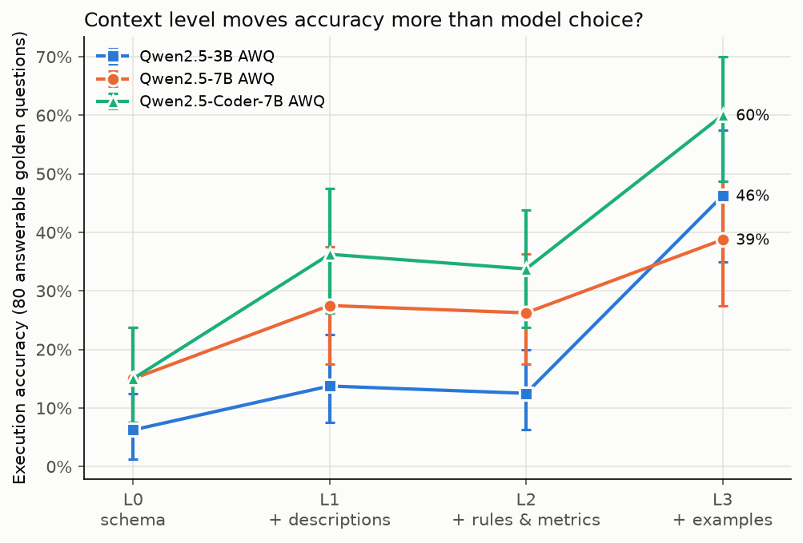
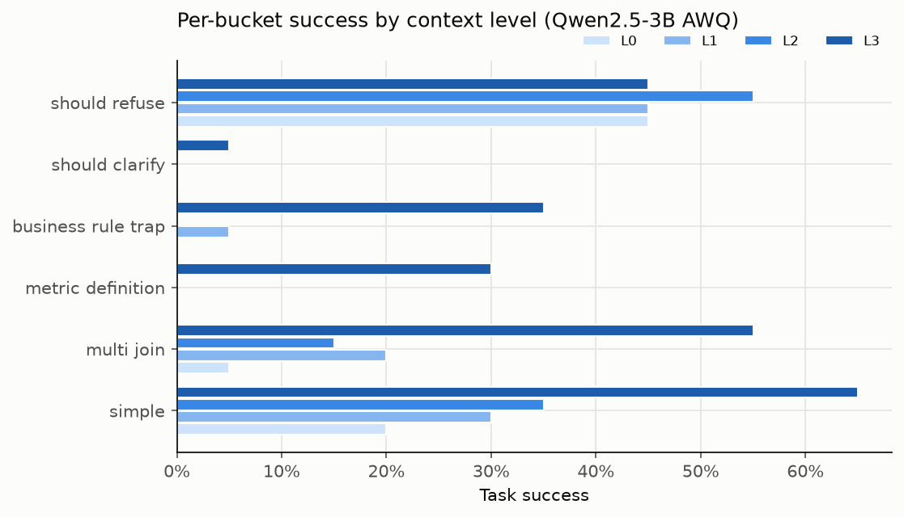
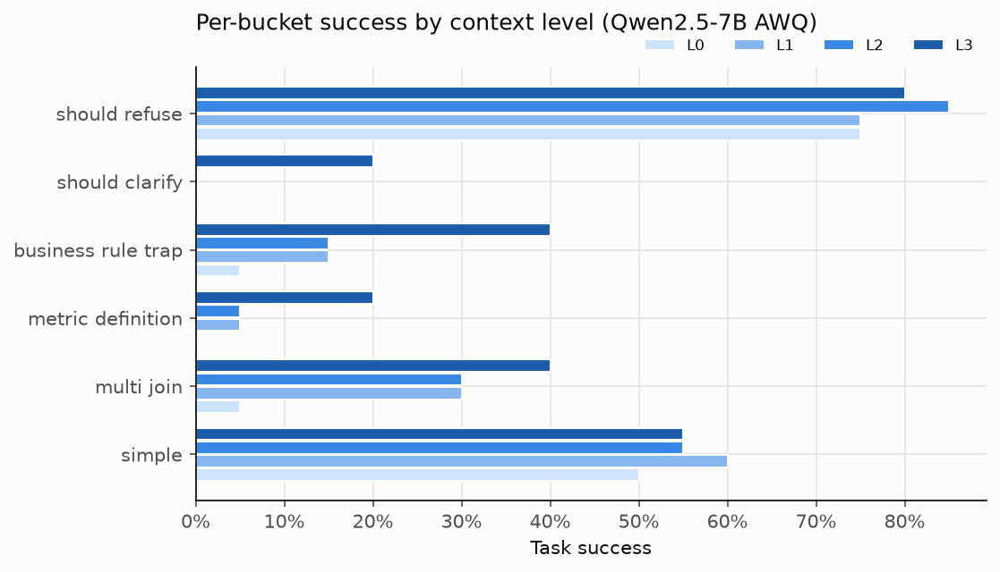
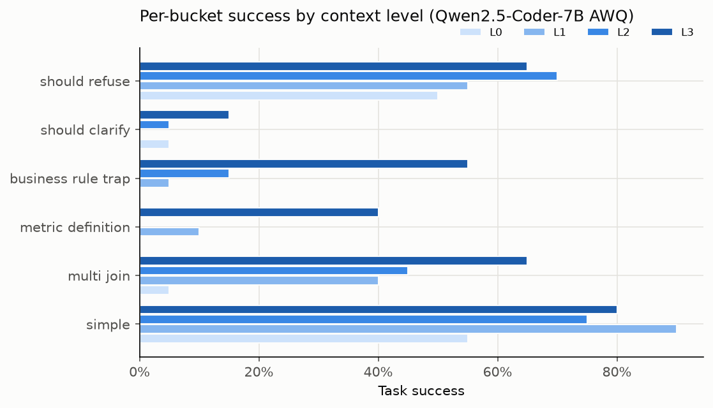

# Results (generated)

> Generated by `lexicon report` from `reports/runs/`. Do not edit by hand.

- **Context effect** (L3 minus L0, mean over models): +36.2 pts (95% CI +27.9 to +44.6).
- **Model effect** (best minus worst model, mean over levels): +18.4 pts (95% CI +13.8 to +24.1).
- **Thesis** (pre-registered, ADR-008): supported: context moved accuracy more than model choice.
- **Decisive cell**: Qwen2.5-3B AWQ at L3 minus Qwen2.5-Coder-7B AWQ at L0: +31.2 pts (95% CI +20.0 to +42.5).

## Ablation: execution accuracy on the 80 answerable golden questions

| Model | L0 | L1 | L2 | L3 |
|---|---|---|---|---|
| Qwen2.5-3B AWQ | 6.2% (1.2% to 12.5%) | 13.8% (7.5% to 22.5%) | 12.5% (6.2% to 20.0%) | 46.2% (35.0% to 57.5%) |
| Qwen2.5-7B AWQ | 15.0% (7.5% to 23.8%) | 27.5% (17.5% to 37.5%) | 26.2% (17.5% to 36.2%) | 38.8% (27.5% to 48.8%) |
| Qwen2.5-Coder-7B AWQ | 15.0% (7.5% to 23.8%) | 36.2% (26.2% to 47.5%) | 33.8% (23.8% to 43.8%) | 60.0% (48.8% to 70.0%) |

Likelihood-ratio tests (logistic model `correct ~ level + model + question`, 64 informative questions):

| Factor dropped | LR chi² | df | p |
|---|---|---|---|
| level | 146.3 | 3 | 1.7e-31 |
| model | 44.5 | 2 | 2.1e-10 |

## Every run

| Run | EX | Task success | Clarify recall | False clarify | Refusal type acc. | Over-refusal | Retrieval recall | Tokens / question | Cost / question |
|---|---|---|---|---|---|---|---|---|---|
| coder7b-L0 | 15.0% | 19.2% | 10.0% | 2.5% | 50.0% | 0.0% | 99.0% | 1,762 | $4.6e-05 |
| coder7b-L1 | 36.2% | 33.3% | 5.0% | 1.2% | 55.0% | 0.0% | 99.0% | 5,732 | $0.00011 |
| coder7b-L2 | 33.8% | 35.0% | 55.0% | 0.0% | 70.0% | 0.0% | 99.0% | 7,629 | $0.00015 |
| coder7b-L3 | 60.0% | 53.3% | 55.0% | 0.0% | 65.0% | 0.0% | 99.0% | 6,964 | $0.00015 |
| qwen3b-L0 | 6.2% | 11.7% | 5.0% | 3.8% | 45.0% | 17.0% | 99.0% | 2,194 | $6.6e-05 |
| qwen3b-L1 | 13.8% | 16.7% | 0.0% | 0.0% | 45.0% | 30.0% | 99.0% | 5,738 | $7.8e-05 |
| qwen3b-L2 | 12.5% | 17.5% | 35.0% | 0.0% | 55.0% | 19.0% | 99.0% | 7,421 | $7.1e-05 |
| qwen3b-L3 | 46.2% | 39.2% | 40.0% | 0.0% | 45.0% | 5.0% | 99.0% | 7,781 | $6.5e-05 |
| qwen7b-L0 | 15.0% | 22.5% | 75.0% | 16.2% | 75.0% | 8.0% | 99.0% | 1,984 | $3.3e-05 |
| qwen7b-L1 | 27.5% | 30.8% | 60.0% | 11.2% | 75.0% | 8.0% | 99.0% | 6,044 | $0.00012 |
| qwen7b-L2 | 26.2% | 31.7% | 65.0% | 10.0% | 85.0% | 7.0% | 99.0% | 7,857 | $0.00021 |
| qwen7b-L3 | 38.8% | 42.5% | 80.0% | 12.5% | 80.0% | 4.0% | 99.0% | 8,245 | $0.00024 |

### Bucket scores

| Run | simple | multi join | metric definition | business rule trap | should clarify | should refuse |
|---|---|---|---|---|---|---|
| coder7b-L0 | 55.0% | 5.0% | 0.0% | 0.0% | 5.0% | 50.0% |
| coder7b-L1 | 90.0% | 40.0% | 10.0% | 5.0% | 0.0% | 55.0% |
| coder7b-L2 | 75.0% | 45.0% | 0.0% | 15.0% | 5.0% | 70.0% |
| coder7b-L3 | 80.0% | 65.0% | 40.0% | 55.0% | 15.0% | 65.0% |
| qwen3b-L0 | 20.0% | 5.0% | 0.0% | 0.0% | 0.0% | 45.0% |
| qwen3b-L1 | 30.0% | 20.0% | 0.0% | 5.0% | 0.0% | 45.0% |
| qwen3b-L2 | 35.0% | 15.0% | 0.0% | 0.0% | 0.0% | 55.0% |
| qwen3b-L3 | 65.0% | 55.0% | 30.0% | 35.0% | 5.0% | 45.0% |
| qwen7b-L0 | 50.0% | 5.0% | 0.0% | 5.0% | 0.0% | 75.0% |
| qwen7b-L1 | 60.0% | 30.0% | 5.0% | 15.0% | 0.0% | 75.0% |
| qwen7b-L2 | 55.0% | 30.0% | 5.0% | 15.0% | 0.0% | 85.0% |
| qwen7b-L3 | 55.0% | 40.0% | 20.0% | 40.0% | 20.0% | 80.0% |

## BIRD Mini-Dev (SQLite), 200-question stratified slice

| Run | Model | Evidence | EX (95% CI) | simple | moderate | challenging |
|---|---|---|---|---|---|---|
| bird-coder7b-ev | Qwen/Qwen2.5-Coder-7B-Instruct-AWQ | yes | 8.5% (5.0% to 12.5%) | 33.3% | 7.7% | 8.2% |
| bird-coder7b-noev | Qwen/Qwen2.5-Coder-7B-Instruct-AWQ | no | 6.0% (3.0% to 9.5%) | 33.3% | 7.7% | 5.4% |
| bird-qwen7b-ev | Qwen/Qwen2.5-7B-Instruct-AWQ | yes | 9.5% (5.5% to 13.5%) | 33.3% | 23.1% | 8.2% |
| bird-qwen7b-noev | Qwen/Qwen2.5-7B-Instruct-AWQ | no | 5.5% (2.5% to 9.0%) | 33.3% | 15.4% | 4.3% |

A slice of Mini-Dev is not the full benchmark, and Mini-Dev is not BIRD's hidden test set. Compare with care.

## Cost per question, measured by Tally

| Run | Calls found in Tally | Mean cost / question |
|---|---|---|
| qwen7b-L3 | 280 / 280 | $0.000242 |

## Seed stability (ADR-021)

The ablation grid above uses one run (`seed = 0`) per `(model, level)` cell (12 runs), amending ADR-008's 3-seed-per-cell plan under the 120 W GPU cap (ADR-017). Three seeds (`seed = 0, 1, 2`) were run on the gate champion and the gate demo to measure temperature-0 seed noise directly:

| Configuration | Runs | Majority EX | Task success | Seed flip rate |
|---|---|---|---|---|
| Champion (`evals/champion.json`) | `qwen7b-L3, qwen7b-L3-s1, qwen7b-L3-s2` | 36.2% | 40.8% | 1.7% |
| Candidate (`demo-no-reopen-rule`) | `demo-no-reopen-rule, demo-no-reopen-rule-s1, demo-no-reopen-rule-s2` | 41.2% | 43.3% | 0.8% |

## ARES gate verdicts

| Candidate | Runs | Seed flip | EX delta | `should_refuse` delta | `should_clarify` delta | Runtime | Verdict | Reason |
|---|---|---|---|---|---|---|---|---|
| `demo-no-reopen-rule` | `demo-no-reopen-rule, demo-no-reopen-rule-s1, demo-no-reopen-rule-s2` | 0.8% | +5.0 pts | -5.0 pts | +0.0 pts | ARES | **FAIL** | protected bucket should_refuse got worse (0.800 -> 0.750) |
| `qwen7b-L3` | `qwen7b-L3, qwen7b-L3-s1, qwen7b-L3-s2` | 1.7% | +0.0 pts | +0.0 pts | +0.0 pts | ARES | **PASS** | within limits over n=120 questions |

### Gate demo: deleting `R-RESOLVED-IS-STATUS` (`demo-no-reopen-rule`)

`evals/gate_demo/context_without_reopen_rule/` removes one business rule (`R-RESOLVED-IS-STATUS`) from the production context and runs all three seeds (`demo-no-reopen-rule`, `demo-no-reopen-rule-s1`, `demo-no-reopen-rule-s2`) against the 3-seed champion (`qwen7b-L3`, `qwen7b-L3-s1`, `qwen7b-L3-s2`).

- **Verdict**: **FAIL** (`protected bucket should_refuse got worse (0.800 -> 0.750)`, plugin `lexicon@1.0.0`, ARES runtime: `True`).
- **Honest finding**: removing the rule did not drop `business_rule_trap` (`0.350 -> 0.400`) and overall EX rose (`0.362 -> 0.412`, +5.0 pts), because Qwen2.5-7B at L3 already missed 4 of the 5 questions citing `R-RESOLVED-IS-STATUS` even with the rule present. The gate blocked the change because the protected `should_refuse` bucket regressed (`0.800 -> 0.750`, one `unanswerable_from_schema` item reclassified as `out_of_scope` in 2 of 3 seeds).
